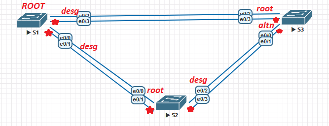
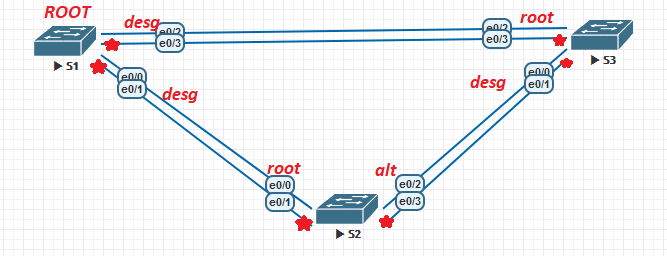

[🇷🇺 Русская версия](README.ru.md)

## Lab 02 — Switched Network with Redundant Links (STP)

### Topology

### Addressing table

| Device | Interface | IP address  | Subnet Mask   |
| ------ | --------- | ----------- | ------------- |
| S1     | VLAN 1    | 192.168.1.1 | 255.255.255.0 |
| S2     | VLAN 1    | 192.168.1.2 | 255.255.255.0 |
| S3     | VLAN 1    | 192.168.1.3 | 255.255.255.0 |

### Goals

- **Part 1.** Build the network and configure basic device parameters
- **Part 2.** Select the Root Bridge
- **Part 3.** Observe STP port selection based on port cost
- **Part 4.** Observe STP port selection based on port priority

### Part 1 — Basic setup

S1

<pre><code>
enable
conf t
hostname S1
line con 0
exec-timeout 0 0
exit
interface vlan 1
ip address 192.168.1.1 255.255.255.0
no shutdown
</code></pre>

S2

<pre><code>
enable
conf t
hostname S2
line con 0
exec-timeout 0 0
exit
interface vlan 1
ip address 192.168.1.2 255.255.255.0
no shutdown
</code></pre>

S3

<pre><code>
enable
conf t
hostname S3
line con 0
exec-timeout 0 0
exit
interface vlan 1
ip address 192.168.1.3 255.255.255.0
no shutdown
</code></pre>

S1, S2, S3 — passwords and banner

<pre><code>
no ip domain-lookup
enable secret cisco
line console 0
password cisco
login
logging synchronous
banner motd "** This is a secure system. Authorized Access Only!"
</code></pre>

### Part 2 — Root Bridge selection

Set all ports to trunk mode, then disable e0/1 and e0/3:

S1, S2, S3

<pre><code>
conf t
interface range e0/0-3
 switchport trunk encapsulation dot1q
 switchport mode trunk
interface e0/1
 shutdown
interface e0/3
 shutdown
</code></pre>

Verify STP: `show spanning-tree`

Root is elected by lowest MAC address (BID priority default 32769). Port e0/0 on S3 is blocked.

### Part 3 — Port cost change

Lower cost on S3 root port to observe topology change:

S3

<pre><code>
interface e0/2
 spanning-tree cost 90
</code></pre>

Restore:

S3

<pre><code>
interface e0/2
 no spanning-tree cost 90
</code></pre>

### Part 4 — Port priority

Re-enable e0/1 and e0/3 on all switches, then observe port selection:

S1, S2, S3

<pre><code>
interface e0/1
 no shutdown
interface e0/3
 no shutdown
</code></pre>

STP tie-breaking order: **path cost → BID → port priority → port number**.

---

[← 01. VLAN](../VLAN/) | [🏠 Home](../README.md) | [03. EtherChannel →](../EtherChannel/)
